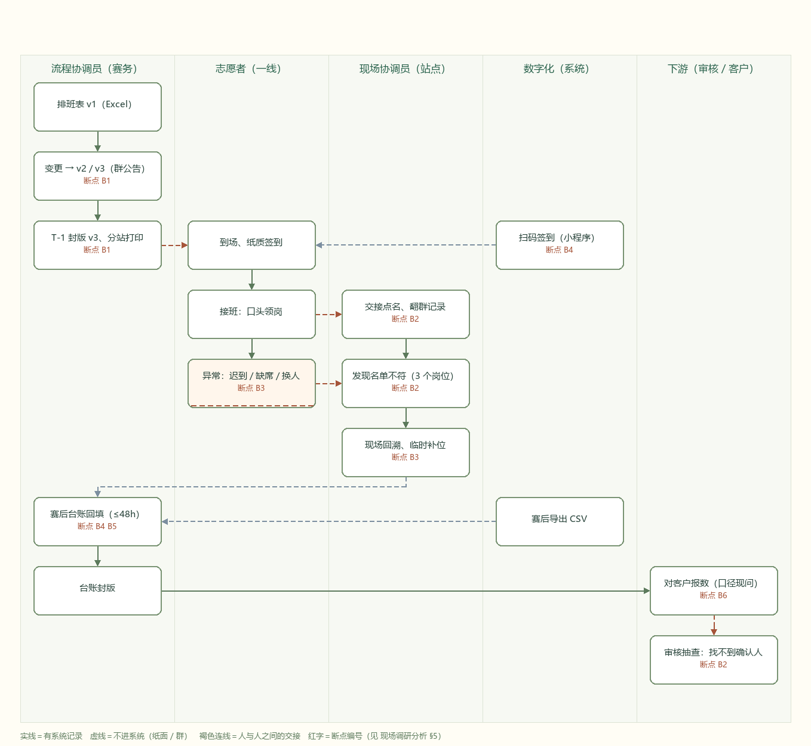
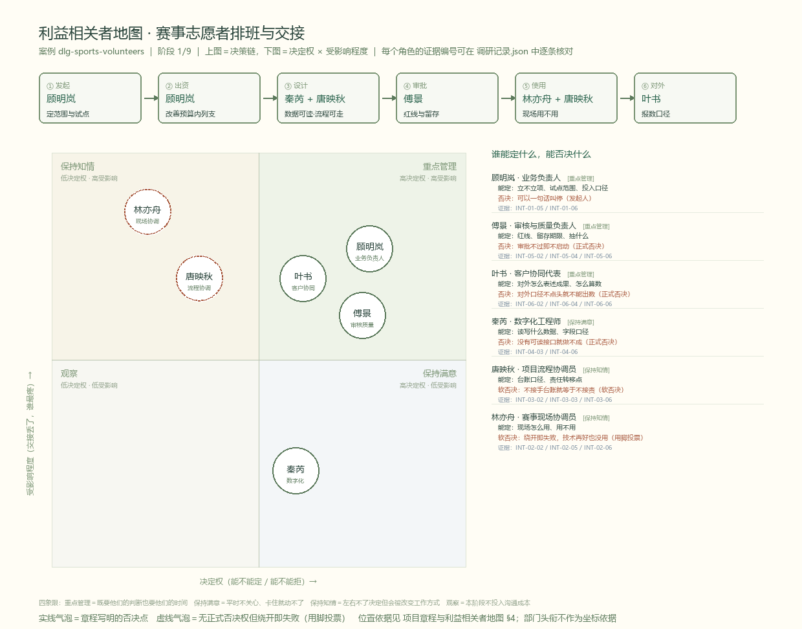

# 志愿者排班与交接 · 业务挖掘与现场调研

[](https://github.com/Leishijia/volunteer/actions/workflows/verify.yml)

> 徽章指向 **main 最近一次运行**，不是某一个提交。单个提交旁的绿/红叉是历史快照，改不了；要看"现在是不是好的"，看这个。
> CI 第一次运行（`b052f98`）是红的，原因是 L1-3 当时按字节比 CSV，Linux 检出 LF、本机 CRLF 造成误报，下一条提交已修（详见 §4.5）。

上海东浩兰生赛事管理有限公司「赛事志愿者排班与交接」——**阶段 1/9 业务挖掘**的完整交付物：
访谈、台账、现场分析、现状流程图，以及四份项目原有资料。

> **资料性质**：合成训练资料（`dlg-sports-volunteers`）。合成训练不代表真实授权、业务执行或客户验收。
> 文中引语为演练访谈整理，**原始凭证全部标记"待补"**，未取得原件前，所有数字只作估计，不作收益承诺。

---

## 一、先看结论

问题不在"排班排不出来"，在**交接那一刻没有唯一口径，也没有留下谁确认过的证据**。

- 触发事件：2026-10-18 07:20 第 1→2 班交接，2 人迟到、1 人临时替换未落单据 → 3 个岗位与排班表 v3 对不上 → 现场协调员往返核对 40 分钟 → 赛后回填台账 2 天。
- 客户说的是"减少重复核对、提高可追溯"——**两个业务结果，不是一个功能**。只做签到工具，重复核对会从三处变四处。
- 结论：**值得立项**，但项目应是"交接时刻的口径统一与留证"，只读核对 + 人工交接，不碰派班、不碰对外验收。
- 试点建议：1 场赛事、2 个站点（一主一对照）、1 个交接窗口。

---

## 二、交付物（两套口径对得上）

### 2.1 按平台三项任务

| 任务 | 任务交付 | 文件 |
|---|---|---|
| 任务 1/3 · 识别业务机会 | 业务机会清单 | [`docs/业务挖掘.md`](docs/业务挖掘.md) §4.3（O-1～O-5） |
| 任务 2/3 · 建立现状基线 | 指标基线与价值假设 | [`docs/现状基线与价值假设.md`](docs/现状基线与价值假设.md) |
| 任务 3/3 · 确认立项与决策链 | 项目章程与利益相关者地图 | [`docs/项目章程与利益相关者地图.md`](docs/项目章程与利益相关者地图.md) + [`docs/图/利益相关者地图.png`](docs/图/利益相关者地图.png) |
| — | 三项结论的可粘贴稿 | [`docs/平台提交稿.md`](docs/平台提交稿.md) |

### 2.2 按调研任务清单 ①–⑤

| # | 交付物 | 文件 | 说明 |
|---|---|---|---|
| ① | 业务挖掘 | [`docs/业务挖掘.md`](docs/业务挖掘.md) | 问题与角色、样本与基线、范围与决定权、**业务机会清单 O-1～O-5**、立项判断 |
| ② | 调研记录 | [`docs/调研记录.md`](docs/调研记录.md)<br>[`docs/调研记录.json`](docs/调研记录.json)<br>[`docs/调研记录.csv`](docs/调研记录.csv) | 六角色访谈（**36 条证据** = 6 × 6）、交叉核对表；JSON 为唯一真源，CSV 由脚本生成 |
| ③ | 现场调研分析 | [`docs/现场调研分析.md`](docs/现场调研分析.md) | 分钟级交接时序、**六个断点 B1–B6**、重复录入路径、根因假设与反证条件 |
| ④ | 项目原有资料（4 份） | [`docs/原始资料/`](docs/原始资料/) | 客户简报、现状信息请求表、业务发现访谈问题库、利益相关者资料与分工 |
| ⑤ | 现状流程图 | [`docs/现状流程图.md`](docs/现状流程图.md)<br>[`docs/图/现状流程图.png`](docs/图/现状流程图.png) / `.svg` / `.mmd` | 五泳道 AS-IS 图，**由代码生成**，断点可追溯到节点 |

**三份补充交付物**（平台任务 2、3 要求，但 ①–⑤ 清单里没有）：

| 交付物 | 为什么补 | 文件 |
|---|---|---|
| 指标基线与价值假设 | 基线不能只停在"估计"——要写清每个数字的证据等级（L0–L4）、价值假设怎么被推翻、拿不到原件怎么降级 | [`docs/现状基线与价值假设.md`](docs/现状基线与价值假设.md) |
| 项目章程与利益相关者地图 | 平台要求"明确发起人、使用者、出资者、审批者，记录访谈授权与调查边界"，这些散在各篇里没有单一出处 | [`docs/项目章程与利益相关者地图.md`](docs/项目章程与利益相关者地图.md) |
| 项目一页纸（开课前填） | 填表式提交件，按课程模板原样三列对齐（青禾示例 / 本项目 / 为什么先定它）：客户、使用人数、业务量、数据在哪、能不能上云——决定走云端 API 还是私有化的那五个问题 | [`docs/项目一页纸.csv`](docs/项目一页纸.csv) |
| 练 1 · 成本拆解表 | 人力／模型／服务器／数据／运维五块逐项测算，合计可复算；并回答"报价模式四选一"及一句话理由 | [`docs/练1-成本拆解表.csv`](docs/练1-成本拆解表.csv) |
| 练 2 · 人天估算与单价表 | 13 个工作包拆到可计数粒度（角色×天数×单价），集成联调与调优轮次单独成行，缓冲 20% 不藏；合计 48 人天 / 11.54 万 | [`docs/练2-人天估算与单价表.csv`](docs/练2-人天估算与单价表.csv) |
| 练 2 附件 · 单价推导 | 月薪×系数÷21.75÷利用率×(1+加成率) 的完整推导，5 个角色同口径，并标注加成率≠毛利率 | [`docs/练2-单价推导.csv`](docs/练2-单价推导.csv) |

### 一眼看懂的两张图





---

## 三、仓库结构

```
volunteer/
├── README.md                  # 本文件：结论、索引、怎么跑
├── LICENSE                    # MIT
├── config.yaml                # 全项目唯一配置：路径、字体、枚举、交付清单
├── requirements.txt           # 依赖（PyYAML；Pillow 可选，注释掉了）
├── .github/workflows/verify.yml  # CI：push / PR 自动跑 harness
├── .githooks/pre-commit       # 提交前拦一道（克隆后需 git config core.hooksPath .githooks）
├── docs/
│   ├── 业务挖掘.md             # ① 阶段 1 主交付（任务 1/3 的业务机会清单在 §4.3）
│   ├── 调研记录.md             # ② 访谈正文（可读版，36 条）
│   ├── 调研记录.json           # ② 结构化真源
│   ├── 调研记录.csv            # ② 台账视图（脚本生成，Excel 可直接开）
│   ├── 现场调研分析.md         # ③ 断点与损失
│   ├── 现状流程图.md           # ⑤ 图 + 节点表 + 读图要点
│   ├── 现状基线与价值假设.md    # 任务 2/3 交付：三口径基线、M1–M6、VH-1～VH-6
│   ├── 项目章程与利益相关者地图.md  # 任务 3/3 交付：章程、决策链、授权与边界
│   ├── 平台提交稿.md           # 三段结论，可直接粘进平台文本框
│   ├── 图/
│   │   ├── 现状流程图.svg / .png / .mmd
│   │   └── 利益相关者地图.svg / .png / .mmd
│   └── 原始资料/               # ④ 四份原始资料（未改动）
│       ├── 01-客户简报.html
│       ├── 02-现状信息请求表.html
│       ├── 03-业务发现访谈问题库.html
│       └── 04-利益相关者资料与分工.html
├── site/                      # 评审看板（线上部署的就是这个目录）
│   ├── index.html             # 单文件，无外部依赖，脚本生成
│   └── assets/                # flow.svg / stakeholders.svg
└── src/
    ├── harness.py             # 统一校验：22 项分六层，一条命令判定能否交付
    ├── build_site.py          # 评审看板：台账 → 单文件静态站（结论/断点/台账/图/边界）
    ├── settings.py            # 配置装载：路径/字体/清单的唯一入口，读不到就报错不猜
    ├── envelope.py            # 对外接口统一结构 {ok,data,error} 与退出码映射
    ├── build_ledger.py        # JSON → CSV，并校验证据编号 / 断点覆盖 / 凭证状态
    ├── render_flow.py         # 现状流程图：一份定义 → SVG + PNG + Mermaid
    └── render_stakeholders.py # 利益相关者地图：象限 + 决策链，并核对证据编号是否真的存在
```

---

## 四、怎么跑

Python 3.10+，第三方依赖只有 **PyYAML**（读 `config.yaml`）；生成 PNG 另需 Pillow（可选，CI 不装）。

```bash
pip install -r requirements.txt
```

配置全部在 [`config.yaml`](config.yaml)：路径、字体候选、台账列名与枚举、交付清单。代码里不写死任何路径、字体或地址。

### 4.1 一条命令跑完所有校验（推荐）

```bash
python src/harness.py            # 22 项全跑，刷新本地 docs/校验报告.md（不入库）
python src/harness.py --list     # 列出检查项，以及每一项"在防什么"
python src/harness.py --only L2  # 只查证据可追溯
python src/harness.py --json     # CI 取统一结构 {"ok","data","error"}
```

退出码 `0` 通过、`1` 有 blocker 失败、`2` harness 自身出错——可以直接挂 CI，不需要额外写判定逻辑。

### 4.2 六层，各管一段

| 层 | 管什么 | 覆盖范围 |
|---|---|---|
| **L1 台账自洽** | JSON 自身合法、证据编号不重复、CSV 是 JSON 的忠实投影 | 36 条证据 / 6 位访谈 / 6 个断点 |
| **L2 证据可追溯** | 文档里每个 `INT-xx-nn`、`Bx`、`DOC-xx` 都能在台账里落地 | 8 篇 Markdown 全量扫描 |
| **L3 图与定义一致** | 6 个生成物（svg/png/mmd × 2）里能复算的 4 个，是否真是当前定义导出的 | 流程图 15 节点 / 地图 6 角色 |
| **L4 文档层** | 交付物齐套、本地链接能点开、新文档进了索引、统计数字没过期 | 23 个交付文件 |
| **L5 代码规范** | 函数都有中文 docstring、代码里没有硬编码路径/地址、四个 CLI 的 `--json` 形状与退出码同向 | 7 个源文件 |
| **L6 上线物** | 站点是不是当前台账的产物、是不是自包含（无 CDN）、五个区块锚点齐不齐 | 36 条证据 / 2 张图 |

每一层都对应一类**单看任何一个脚本都发现不了**的毛病：改了 JSON 忘重生成 CSV、结论引用台账里没有的证据、改了流程忘重跑脚本、README 链接指向改过名的文件。所以它不是三个 `--check` 的包装，而是补上了跨文件那一段。

`docs/校验报告.md` 是这条命令的产物（**写在本地，不进仓库**，见 `.gitignore`），逐条列「编号 / 检查项 / 这一项在防什么 / 结论」，评审可以顺着报告反向核对，不用信我口头说"都查过了"。

### 4.3 单独重跑某个生成器

```bash
# 1. 台账
python src/build_ledger.py          # 生成 docs/调研记录.csv
python src/build_ledger.py --check  # 只校验，出错返回非零

# 2. 现状流程图
python src/render_flow.py           # 生成 docs/图/ 下的 svg / png / mmd
python src/render_flow.py --check   # 只校验节点、连线和断点编号

# 3. 利益相关者地图
python src/render_stakeholders.py         # 生成 docs/图/利益相关者地图.svg / .png / .mmd
python src/render_stakeholders.py --check # 只校验坐标、否决类型与证据编号
```

改了任何数据源，重跑生成器之后**再跑一次 harness**：L1-3、L3-2/L3-4、L3-5/L3-6 就是专门盯"生成物过期"的。

这三个 `--check` 只做**单点自检**，输出里也会这么提示你：它们不检查跨文件一致性，也不判定"能不能交付"。交付判定只认 `python src/harness.py`。

### 4.4 误报了怎么办

不许删检查。在那一行末尾加注释申辩：

```markdown
…越界的 `B7` 直接匹配不上… <!-- harness:ignore B7 -->
```

`<!-- harness:ignore -->` 跳过整行，`<!-- harness:ignore B7 DOC-05 -->` 只放过指定 token。误报说明检查的判据还不够细，而不是说明检查不该存在——先把豁免写清楚，再回头改判据。


### 4.5 自动化：什么时候自动跑

一套判据，两处触发，都只调 `python src/harness.py`，不复制任何判断逻辑：

| 触发 | 载体 | 行为 |
|---|---|---|
| push / PR | `.github/workflows/verify.yml` | 自动跑 harness；失败则 job 标红，报告追加到 Actions 的 Summary，另存 JSON artifact |
| 提交前 | `.githooks/pre-commit` | 红了直接中止 commit，并打印失败项 |

hook 在 `.git/hooks` 之外，**克隆后要启用一次**（`.git` 里的东西不入库）：

```bash
git config core.hooksPath .githooks
```

临时跳过本地那一次：`SKIP_HARNESS=1 git commit ...`。CI 不认这个开关——跳过只影响你自己这一次。

CI 不装 Pillow，但**要装 PyYAML**（`pip install -r requirements.txt`）——读 `config.yaml` 靠它。本地克隆后同样要装一次，否则 hook 会以退出码 2 中止提交并提示装依赖。

CSV 的同步比对按**内容**做，不比字节：CSV 是文本文件，git 检出时会按平台转换行尾（Windows 给 CRLF、Linux 给 LF）。比字节会让本地绿、CI 红，而且报出来的
「重新生成」根本修不好——内容本来就是一致的。这个坑 CI 第一次跑就踩到了。

**怎么判断"现在是好的"**：看文件顶部的徽章。它指向 main 最近一次运行，绿色即当前全绿。单个提交旁的绿/红叉是**不可变的历史快照**，GitHub 不会追溯重跑：

- `b052f98`（启用 CI 的那个提交）→ run #1 红，就是上面那个 CRLF 误报；
- `b491372`（紧接着的修复）→ run #2 起转绿，此后每次 push 都绿。

旧提交重跑也还是红——它里面的代码就带着那个 bug。抹掉只能改写历史，代价是把"红了 → 查明 → 修掉"的过程一起删掉，而那正是第 10 条纪律的来源，所以留着。


### 4.6 代码规范

四条规范，能机器验的已经做成了 L5 检查，验不了的如实标注：

| 规范 | 怎么落地 | 谁在守 |
|---|---|---|
| 每个函数写中文 docstring，说清**入参 / 出参 / 失败时的行为** | `src/*.py` 全部函数（含 `to_png` 里的嵌套闭包）统一三段式 | **L5-1**（warn） |
| 关键业务逻辑写"**为什么**这么卡"的行内注释 | 校验只收错误不提前返回、CSV 比内容不比字节、报告排除自身路径、断点必须有人说过……每处都写清"不这么做会怎样" | 评审（无法自动验） |
| 配置统一进 `config.yaml`，禁止硬编码密钥 / 地址 / 路径 | 路径、字体候选、列名枚举、交付清单全部经 `settings.py` 读配置；`src/` 里出现盘符、系统目录或 http 地址即判失败 | **L5-2**（blocker） |
| 对外接口统一返回 `{"ok": bool, "data": …, "error": {"code","msg"}}` | 四个 CLI 的成功与失败都由 `envelope.py` 构造；`--json` 输出同一形状，且 `ok` 必须与退出码同向 | **L5-3**（blocker） |

**为什么第二条不做成检查**：机器只能验"有没有注释"，验不了"注释解不解释为什么"。真做成检查，用 `# 增加一行` 这种注释就能骗过去——那种检查比没有更糟，因为它给了虚假的保证。所以这条只写进评审清单。

**接口形状的机器判定标准**（L5-3 实际执行）：真去跑 `python src/<脚本>.py --check --json`，解析 stdout，要求顶层键恰好是 `ok/data/error`、`ok` 是布尔值、失败时 `error` 含 `code` 与 `msg`、且 `ok=True ⟺ 退出码 0`。最后一条最要紧：CI 看退出码、hook 看 `ok`，两者不同向就会得出相反结论。

**错误码**（稳定，可编程判断）：

| code | 含义 | 退出码 |
|---|---|---|
| `VALIDATION_FAILED` | 内容不合格，改内容 | 1 |
| `INPUT_MISSING` / `INPUT_INVALID` | 输入文件缺失或格式坏 | 2 |
| `CONFIG_MISSING` / `CONFIG_INVALID` | `config.yaml` 缺失或写错 | 2 |
| `DEPENDENCY_MISSING` / `FONT_MISSING` | 依赖没装、字体候选全不存在 | 2 |
| `NO_CHECKS_MATCHED` | `--only` 没匹配到任何检查项 | 2 |


### 4.7 上线：评审看板

```bash
python src/build_site.py            # 生成 site/index.html + assets/（改完台账必跑）
python src/build_site.py --check    # 只算不写，看站点是否已过期
```

站点是**单文件 + 两张图**，无 JS 框架、无 CDN、无在线字体。这么做不是为了省事，是因为评审者的网络和你不一样：引一个外网字体，内网打开就是白屏加方块字，而且这个故障在你这台机器上永远复现不了。

页面结构对应评审的真实路径，不是按文档目录抄的：

| 区块 | 回答什么问题 |
|---|---|
| 结论 | 值不值得做、范围划到哪、试点多大 |
| 触发事件 | 为什么会开始查这件事 |
| 六个断点 | 具体哪里坏了；**点卡片直接筛出该断点的证据** |
| 两张图 | 现状全貌、谁影响谁 |
| 台账 | 每条结论的证据与原话，可按角色/性质/断点/关键词筛 |
| 边界 | 这些证据只到 L2，所以不承诺收益；明确不做的三件事 |

**站点必须入库**，因为部署取的就是 `site/` 这个目录，而 L6 靠比对磁盘文件判断"线上那份是不是当前台账的产物"。忘记重跑 `build_site.py` 时，L6-1 会报出第一处差异的行号和两侧片段——不会出现"仓库全绿、线上还是旧结论"。

线上地址：<https://volunteer-handover-review.app.workbuddy.host/?sharecode=MI54P7BOHE>

**这个地址是稳定的**：重新发布是"覆盖"同一个应用，链接、名字都不变，内容即时替换——旧链接打开就是新内容，不需要重新分发。前提有两个，破了就会换成一个新链接：

1. 在本机同一个目录（`site/`）上发布。发布平台靠 `.wbapp_*.genie` 把目录映射到应用，这个文件被删或被移动，就会被当成一个新应用。
2. 不手动在平台上新建同名应用。一个目录只对应一个应用，链接是在首次发布时确定的。

反过来也要清楚：**`publish.py` 只更新仓库，不会把站点推上云**。改了台账、跑完 `publish.py` 之后，线上仍是上一版，L6 也查不出来（它只比对仓库里那份是不是当前数据的产物）。所以顺序是：改数据 → `build_site.py` → 发布到云 → `publish.py`。

### 4.8 发布：一条命令完成"生成 → 校验 → 提交 → 推送"

```bash
python src/publish.py               # 重建站点 + 跑 22 项校验 + 提交 + 推送
python src/publish.py --check       # 只判断站点是否过期、有哪些改动待提交
python src/publish.py -m "docs: 补第 4 位受访者"   # 自定义提交信息
```

"上线"其实是两件不同步的事：**云上那份页面**（评审者打开看到的）和**仓库那份代码**（CI 与接手的人看到的）。分成两步手做一定漂——重新生成了却没提交，线上是新的而 CI 全绿；提交了却没生成，仓库是新的而线上还是旧结论。两种状态在本地都不报错，只有下一个人打开链接时才发现。

`publish.py` 把这两件事串起来，任何一步失败就停在那儿：

| 步 | 做什么 | 失败时 |
|---|---|---|
| 1 重建 | `build_site.build()` 重写 `site/` | 台账缺失/损坏 → 退出码 2 |
| 2 校验 | 跑 `harness.py --json`，22 项全绿才继续 | 任一项红 → **不提交不推送**，退出码 1 |
| 3 提交 | `git add -A` + commit | 无改动则跳过（不算失败） |
| 4 推送 | `git push` | 推送被拒 → 本地提交保留并报出原因，退出码 2 |

云发布仍走本机发布通道（不在仓库里，也没有可提交的凭证），这个脚本只负责"仓库与站点一致并推到远端"。顺序固定：**先发布到云 → 再 `publish.py`**，这样线上和仓库是同一份产物。

#### 提交即推送（`post-commit` 钩子）

第 4 步不用等 `publish.py`——`.githooks/post-commit` 在每次提交成功后立刻推送，所以"写完"和"同步完"是同一件事。手动 `git commit` 也一样会被推上去。

钩子刻意只做推送，三道闸门分明：

| 闸门 | 谁在做 | 拦住什么 |
|---|---|---|
| 提交前 | `.githooks/pre-commit` | 校验不过的提交（本地就红，不进历史） |
| 提交后 | `.githooks/post-commit` | 本地领先远端（提交即上传） |
| 推送后 | `.github/workflows/verify.yml` | 换机器/绕过钩子导致的漏检 |

它跳过这几种情况，都打印原因：`SKIP_AUTOPUSH=1`、rebase 或合并进行中、detached HEAD、分支还没有上游（首次需 `git push -u origin <branch>`）。

**推送失败不会回滚提交**：提交已经在本地历史里，钩子只报原因（含 TLS 那类错误的排查方向）并以 0 退出，避免让上层脚本误判"提交失败"。网络恢复后 `git push` 一次即可。


CI 不部署（部署需要本机的发布通道），它只跑 L6 保证入库的那份没过期。

---

## 五、方法与纪律

1. **先问事实，再问需求**。访谈问题库里"你希望有什么系统"这类问题一律放到最后，先问"最近一次出事是哪次"。
2. **单源不进结论**。`调研记录.csv` 里有"交叉核对"列，11 条单源陈述明确标出，不做依据。
3. **数字必须带口径**。"交接 8–15 分钟"附分子分母与取数方式，没口径的数字不写。
4. **数字必须带证据等级**。L0 演练假设 → L1 单源 → L2 交叉 → L3 凭证复算 → L4 计时样本；本案目前最好只到 L2（`现状基线与价值假设.md` §1.1）。
5. **功能 ≠ 结果**。客户说的每个功能都翻译成业务结果，再判断要不要做（`业务挖掘.md` §4.2）。
6. **图由代码生成**。改流程就改数据，图和文档不会各说一套。
7. **假设要能被推翻**。价值假设一律写成"若…那么…｜怎么验｜什么情况下不成立"（`现状基线与价值假设.md` §4）。
8. **不越界**。阶段 1 不画目标态、不给方案、不承诺收益。
9. **交付前先跑 `python src/harness.py`**。绿了才算交付完成；红了先修，不许在报告里写"已知问题"绕过。CI 与 pre-commit 会自动跑，但那是兜底，不是替你判断的借口。
10. **校验项必须能被证伪**。新加一条检查，要先用一次**故意注入的错**证明它会红——不会红的检查等于没有。这套 harness 的 L2-2 就是这么被揪出来的：最初正则写成 `B[1-6]`，越界的 `B7` 直接匹配不上，反向测试才暴露。<!-- harness:ignore B7 -->
11. **规范要能被机器验，否则三周后就没了**。写进 README 的约定不如写进 harness 的检查：`L5-1`～`L5-3` 就是四条代码规范里能自动判的三条；判不了的那条明确写"只靠评审"，不假装覆盖。
12. **上传不是"动作"，是默认结果**。提交即推送（`.githooks/post-commit`）。本地不该长期出现"领先远端几个提交"的状态——那意味着有人在靠记忆做一件本该自动的事。唯一例外是历史改写期间（`SKIP_AUTOPUSH=1`），改写完要一次性推干净，别留下半截。

---

## 六、已知不足（下一步要补的）

| 缺口 | 影响 | 补法 |
|---|---|---|
| 四份原始凭证（DOC-01～04）未取得 | 全部基线停在 L1–L2，M1/M2/M5 无法验收 | 向唐映秋、林亦舟、傅景索取，按脱敏范围登记（`现状基线与价值假设.md` §8 有降级方案） |
| 交接时长无分位数 | 平均值会掩盖"慢的那几次" | 一场赛事 12 次交接做计时样本（S-01） |
| 客户报数口径未书面化 | 试点验收容易被口径反复拖住 | 叶书 + 顾明岚确认一页口径说明（章程门槛 2） |
| 一线接受度未验证 | 工具做得再好也可能被绕开 | 试点前找 2 名组长做一次白纸推演（章程门槛 4） |
| 预算科目与额度未书面 | 章程第 ② 段"出资"走不通 | 顾明岚确认列支科目与是否走采购 |

---

## 七、许可

MIT，见 [LICENSE](LICENSE)。
