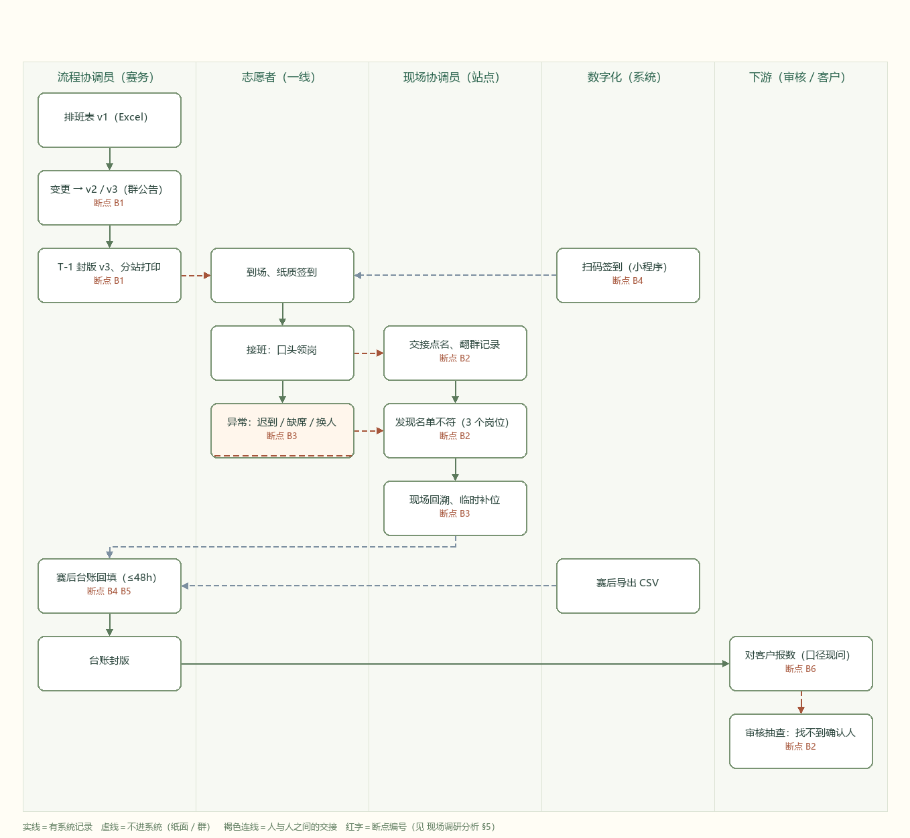

# 志愿者排班与交接 · 业务挖掘与现场调研

上海东浩兰生赛事管理有限公司「赛事志愿者排班与交接」——**阶段 1/9 业务挖掘**的完整交付物：
访谈、台账、现场分析、现状流程图，以及四份项目原有资料。

> **资料性质**：合成训练资料（`dlg-sports-volunteers`）。合成训练不代表真实授权、业务执行或客户验收。
> 文中引语为演练访谈整理，**原始凭证全部标记"待补"**，未取得原件前，所有数字只作估计，不作收益承诺。

---

## 一、先看结论

问题不在"排班排不出来"，在**交接那一刻没有唯一口径，也没有留下谁确认过的证据**。

- 触发事件：2026-10-18 07:20 第 1→2 班交接，2 人迟到、1 人临时替换未落单据 → 3 个岗位与排班表 v3 对不上 → 现场协调员往返核对 40 分钟 → 赛后回填台账 2 天。
- 客户说的是"减少重复核对、提高可追溯"——**两个业务结果，不是一个功能**。只做签到工具，重复核对会从三处变四处。
- 结论：**值得立项**，但项目应是"交接时刻的口径统一与留证"，只读核对 + 人工交接，不碰派班、不碰对外验收。
- 试点建议：1 场赛事、2 个站点（一主一对照）、1 个交接窗口。

---

## 二、五份交付物

对应调研任务清单 ①–⑤：

| # | 交付物 | 文件 | 说明 |
|---|---|---|---|
| ① | 业务挖掘 | [`docs/业务挖掘.md`](docs/业务挖掘.md) | 问题与角色、样本与基线、范围与决定权、**业务机会清单 O-1～O-5**、立项判断 |
| ② | 调研记录 | [`docs/调研记录.md`](docs/调研记录.md)<br>[`docs/调研记录.json`](docs/调研记录.json)<br>[`docs/调研记录.csv`](docs/调研记录.csv) | 六角色访谈（32 条证据）、交叉核对表；JSON 为唯一真源，CSV 由脚本生成 |
| ③ | 现场调研分析 | [`docs/现场调研分析.md`](docs/现场调研分析.md) | 分钟级交接时序、**六个断点 B1–B6**、重复录入路径、根因假设与反证条件 |
| ④ | 项目原有资料（4 份） | [`docs/原始资料/`](docs/原始资料/) | 客户简报、现状信息请求表、业务发现访谈问题库、利益相关者资料与分工 |
| ⑤ | 现状流程图 | [`docs/现状流程图.md`](docs/现状流程图.md)<br>[`docs/图/现状流程图.png`](docs/图/现状流程图.png) / `.svg` / `.mmd` | 五泳道 AS-IS 图，**由代码生成**，断点可追溯到节点 |

### 一眼看懂的图



---

## 三、仓库结构

```
volunteer/
├── README.md                  # 本文件：结论、索引、怎么跑
├── LICENSE                    # MIT
├── docs/
│   ├── 业务挖掘.md             # ① 阶段 1 主交付
│   ├── 调研记录.md             # ② 访谈正文（可读版）
│   ├── 调研记录.json           # ② 结构化真源
│   ├── 调研记录.csv            # ② 台账视图（脚本生成，Excel 可直接开）
│   ├── 现场调研分析.md         # ③ 断点与损失
│   ├── 现状流程图.md           # ⑤ 图 + 节点表 + 读图要点
│   ├── 图/
│   │   ├── 现状流程图.svg
│   │   ├── 现状流程图.png
│   │   └── 现状流程图.mmd
│   └── 原始资料/               # ④ 四份原始资料（未改动）
│       ├── 01-客户简报.html
│       ├── 02-现状信息请求表.html
│       ├── 03-业务发现访谈问题库.html
│       └── 04-利益相关者资料与分工.html
└── src/
    ├── build_ledger.py        # JSON → CSV，并校验证据编号 / 断点覆盖 / 凭证状态
    └── render_flow.py         # 现状流程图：一份定义 → SVG + PNG + Mermaid
```

---

## 四、怎么跑

只依赖 Python 3.10+ 标准库（`render_flow.py` 生成 PNG 时用 Pillow）：

```bash
# 1. 校验调研记录并生成台账
python src/build_ledger.py          # 生成 docs/调研记录.csv
python src/build_ledger.py --check  # 只校验，出错返回非零（可挂 CI）

# 2. 重画现状流程图
python src/render_flow.py           # 生成 docs/图/ 下的 svg / png / mmd
python src/render_flow.py --check   # 只校验节点、连线和断点编号
```

校验会拦住三类常见毛病：

- 证据编号与所属访谈不一致；
- 结论引用了没有访谈记录支撑的断点；
- 标了原始凭证编号，却把状态写成"不适用"。

---

## 五、方法与纪律

1. **先问事实，再问需求**。访谈问题库里"你希望有什么系统"这类问题一律放到最后，先问"最近一次出事是哪次"。
2. **单源不进结论**。`调研记录.csv` 里有"交叉核对"列，11 条单源陈述明确标出，不做依据。
3. **数字必须带口径**。"交接 8–15 分钟"附分子分母与取数方式，没口径的数字不写。
4. **功能 ≠ 结果**。客户说的每个功能都翻译成业务结果，再判断要不要做（`业务挖掘.md` §4.2）。
5. **图由代码生成**。改流程就改数据，图和文档不会各说一套。
6. **不越界**。阶段 1 不画目标态、不给方案、不承诺收益。

---

## 六、已知不足（下一步要补的）

| 缺口 | 影响 | 补法 |
|---|---|---|
| 四份原始凭证（DOC-01～04）未取得 | M1/M2/M5 全停在"估计" | 向唐映秋、林亦舟、傅景索取，按脱敏范围登记 |
| 交接时长无分位数 | 平均值会掩盖"慢的那几次" | 一场赛事 12 次交接做计时样本 |
| 客户报数口径未书面化 | 试点验收容易被口径反复拖住 | 叶书 + 顾明岚确认一页口径说明 |
| 一线接受度未验证 | 工具做得再好也可能被绕开 | 试点前找 2 名组长做一次白纸推演 |

---

## 七、许可

MIT，见 [LICENSE](LICENSE)。
