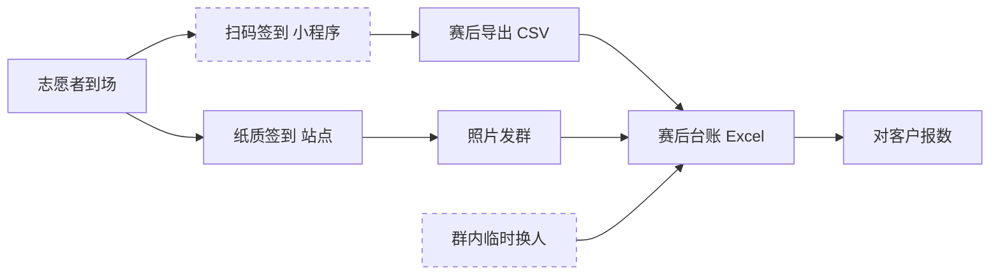

# 现场调研分析 · 赛事志愿者排班与交接

> 案例编号：`dlg-sports-volunteers` ｜ 阶段 1/9 ｜ 样本：2026-10-18「东岸半程马拉松」（合成演练设定）
> 依据：`docs/调研记录.md`（INT-01～INT-06）、`docs/现状流程图.md`（MAP-01）、`docs/业务挖掘.md`（口径与指标）

---

## 0. 一句话结论

**问题不在"排班排不出来"，在"交接那一刻没有唯一口径，也没有留下谁确认过的证据"。**
所有六个角色从各自角度指到了同一处，只是对"该谁负责"各有说法。

---

## 1. 现场看什么

不讲"流程"，只看四件事：

| 看什么 | 具体记录 | 用途 |
|---|---|---|
| 时刻 | 每个动作发生在几点几分（精确到分） | 算时效（M1、M4） |
| 动作 | 谁在做、做了几步、手动还是口头 | 找断点位置 |
| 载体 | 纸、手机、群、对讲机、Excel | 找重复录入 |
| 人 | 谁有权拍板、谁只是传话 | 定责任转移点 |

**不做的事**：不现场追问"你们需要什么系统"。一问就把事实问成了方案。

---

## 2. 样本现场（观察记录）

| 编号 | 观察点 | 记录 | 关联证据 |
|---|---|---|---|
| OBS-01 | 07:20 第 1→2 班交接，4 号站 | 上一班组长在微信群发"交接：XX 岗 A、XX 岗 B"，下一班组长按纸质签到表逐人核对，翻群记录找临时换人那条，中途打了一通电话 | INT-02-02 |
| OBS-02 | 07:26 发现不一致 | 3 个岗位姓名与排班表 v3 不一致（2 人迟到未到、1 人已替换） | INT-02-02 |
| OBS-03 | 07:30–08:10 处置 | 现场协调员从 2 号站步行返回 4 号站，现场点人，用对讲机补位；3 个岗位期间无固定值守 | INT-02-03 |
| OBS-04 | 09:00 站内复核 | 站长再核一遍签到表与群消息，仍未形成统一版本 | INT-03-02 |
| OBS-05 | 赛后 48 小时内 | 台账回填：签到照片逐张录入、群消息逐条对照，本次事件延至 2 天完成 | INT-03-06 |

---

## 3. 一场赛事的时间轴（T-7 → 赛后 3 天）

| 时点 | 发生什么 | 谁 | 载体 | 断点 |
|---|---|---|---|---|
| T-7 | 排班表 v1 发布到赛事群 | 唐映秋 | Excel + 群文件 | — |
| T-3 | 因报名变更出 v2 | 唐映秋 | Excel + 群公告 | B1 |
| T-1 | 封版 v3，打印分站签到表 | 唐映秋 / 林亦舟 | Excel → 纸 | B1 |
| 当日 06:30 | 志愿者到场，纸质签到，组长口头派岗 | 林亦舟 + 组长 | 纸 + 口头 | B3 |
| 当日 07:20 | 第 1→2 班交接：群里一句 + 纸质点名 | 组长 | 手机群 + 纸 | **B2** |
| 当日 07:26 | 发现 3 个岗位不符 | 组长 | 口头 + 群 | B2 B3 |
| 当日 07:30–08:10 | 现场协调员往返核对、临时补位 | 林亦舟 | 对讲机 | B3 |
| 当日 10:30 / 14:30 | 后续两次交接，同一做法重复 | 组长 | 手机群 + 纸 | B2 |
| 赛后 0–48h | 台账回填（照片 + 群记录） | 唐映秋 | Excel | B4 B5 |
| 赛后 1–3d | 对客户报数，口径被追问 | 叶书 | 邮件/口头 | B6 |
| 抽查时 | 无法提供"谁何时确认了哪个岗位" | 傅景 | — | B2 |

---

## 4. 交接窗口里到底发生了什么（以 07:20 那次为例）

| 分钟 | 动作 | 判断 |
|---|---|---|
| 0 | 上一班组长在群里发一行字 | 通知 ≠ 确认，没有回执要求 |
| 1–2 | 下一班组长掏手机、解锁、找群、翻记录 | 现场成本：手套 + 风 + 信号一格 |
| 3–6 | 拿纸质签到表逐人点名 | 事实来自纸，与系统无关 |
| 7–8 | 发现 3 处姓名对不上 | 差异无法当场判定"是换人还是记错" |
| 9 | 打电话问上一班组长 | 唯一可用的核对渠道是人 |
| 10+ | 上报现场协调员，等待其到场 | 升级无时限，只能等 |
| 40 | 现场核点完毕，补位 | 空窗代价：3 个岗位 |

**关键发现**：这 15 分钟里，**没有任何一个动作会产生可追溯记录**。唯一留下的是一张群聊截图——而审核明确不认。

---

## 5. 六个断点

| 编号 | 断点 | 表现 | 证据 | 影响 | 放大量（每场） | 一线绕行做法 | 根因假设 | 待验证 |
|---|---|---|---|---|---|---|---|---|
| **B1** | 排班多版本并存 | v1/v2/v3 同时在群文件与纸上流转，无版本号 | INT-01-02、INT-03-02、INT-04-04 | 现场拿到的不一定是封版 | 每次改版 1 轮口头确认 | 认"最后一条群消息" | 变更没有单一出口 | DOC-01 版本记录 |
| **B2** | 交接确认无签字、无时间戳 | 责任转移点悬空，只有口头与截图 | INT-02-06、INT-03-03、INT-05-04 | 审计无法举证；纠纷回到"谁说过" | 12 次/场 | 群里回"接班确认"，截图即台账 | 交接单停用后无替代物 | 交接单何时停用 |
| **B3** | 换人不回填、异常无升级时限 | 临时替换只在群里说一句；异常靠人催 | INT-02-02、INT-03-05、INT-05-05 | 岗位空窗，客户侧来电 | 本次 3 岗 × 40 分钟 | 现场协调员跑回去 | 缺"变更即登记"的动作 | 是否有线下登记本 |
| **B4** | 同一事实三处重复录入 | 扫码签到 → 纸质签到 → 赛后台账 | INT-03-01、INT-04-01、INT-04-05 | 重复核对，口径互相打脸 | 每条在岗事实录 2–3 次 | 只信纸，系统数据不用 | 系统不接现场条件 | 扫码失败率 |
| **B5** | 台账靠照片与记忆回填 | 赛后逐张对照片、逐条翻群 | INT-03-06 | 返工 16 人时，本次拖 2 天 | 1 场 | 让组长赛后补一句 | 现场没留下结构化事实 | DOC-03 工时 |
| **B6** | 对外口径未书面化 | 迟到/换人算不算在岗，每次现问 | INT-06-01、INT-06-02 | 报数反复，客户信任受损 | 2 次 × 0.5h | 按"人在就行"先报，后补 | 口径没有书面定义 | 客户确认口径 |

---

## 6. 一条"在岗事实"被录了几次

- 虚线是**不进系统**的两处：扫码失败退回的纸质、群里的临时变更。
- 结果是：**同一件事录 2–3 次，且每次都可能不同**。核对之所以重复，是因为从来没有一个"唯一版本"。

---

## 7. 成本盘点（口径见 `业务挖掘.md` §2.2）

| 成本项 | 现状 | 折算 | 状态 |
|---|---|---|---|
| 交接核对 | 12 次/场 × 8–15 分钟 | 约 2.2 人时/场 | 估计，待计时样本 |
| 异常回溯 | 本次 40 分钟 + 3 岗空窗 | 0.7 人时 + 服务中断 | 事件记录 |
| 赛后回填 | 2 人 × 1 天（本次） | 16 人时/场 | 单源，待 DOC-03 |
| 客户口径澄清 | 2 次 × 0.5 小时 | 1 人时/场 | 单源 |
| 审计风险 | 无法举证 | 不可量化 | 审核确认 |

> 一年 12 场粗算约 240 人时（`［待核］`）。这个数不用于承诺收益，只用于说明"值不值得动"。

---

## 8. 根因假设与反证条件

| 假设 | 支持证据 | **什么情况下会被推翻** | 推翻后怎么办 |
|---|---|---|---|
| H1 问题集中在交接窗口 | 六角色一致指向 07:20；三次交接同一做法 | 计时显示大部分时间花在排班生成与派单 | 试点位置整体前移到排班变更 |
| H2 在岗事实被重复录入 | 扫码/纸质/台账三处 | 实际上纸质台账已废弃，只用于留档 | 单点录入价值下降，改做"留证"就够 |
| H3 不可追溯是因为没有落到人+时间 | 交接单停签、审核只看三要素 | 交接单仍在签，只是没归档 | 只补归档流程，不建新工具 |

**先验哪条**：H3 → H2 → H1。理由：H3 验证最便宜（查一次历史抽查记录），且它的结论会直接改变试点形态。

---

## 9. 与客户原始诉求的偏差

| 客户说 | 现场实际 | 偏差 | 处理 |
|---|---|---|---|
| 减少重复核对 | 重复核对的根因是"三个版本 + 三次录入" | 客户以为是"人多手忙" | 用 B1/B4 的证据说明 |
| 提高可追溯性 | 现场已有"截图台账"，但不被审核承认 | 双方对"可追溯"定义不同 | 落地为三要素：谁、何时、哪个岗位 |
| 想上排班/交接系统 | 现场最缺的是"变更即登记"这一个动作 | 功能 ≠ 结果 | 先做只读核对 + 留证，不碰派班 |

---

## 10. 结论

**改什么**：交接窗口的三个动作——变更即登记、确认落人落时间、不一致自动升级并有兜底。

**不改什么**：派班逻辑、排班算法、身份核验、对外报数。

**先验什么**：DOC-01～DOC-03 三份原件；再拿一次真实交接做计时样本。三份原件拿不到，本分析的全部数字都只能停在"估计"。
