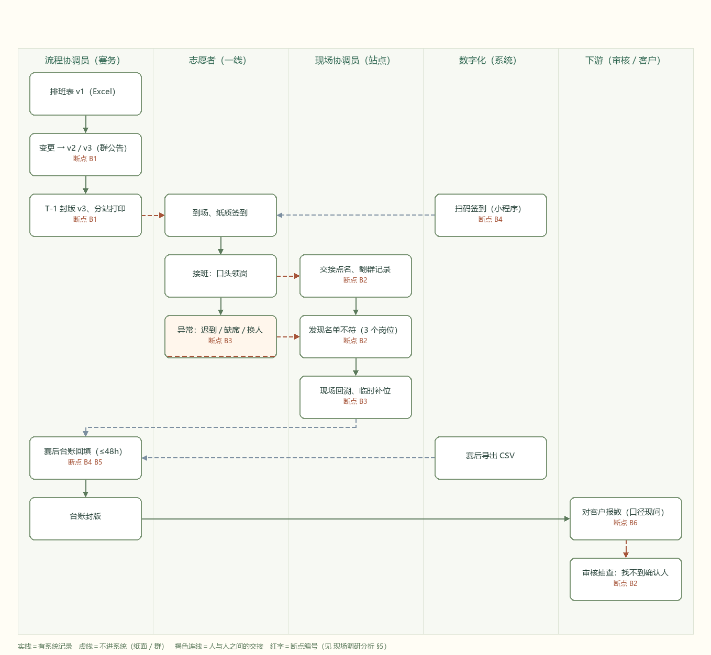
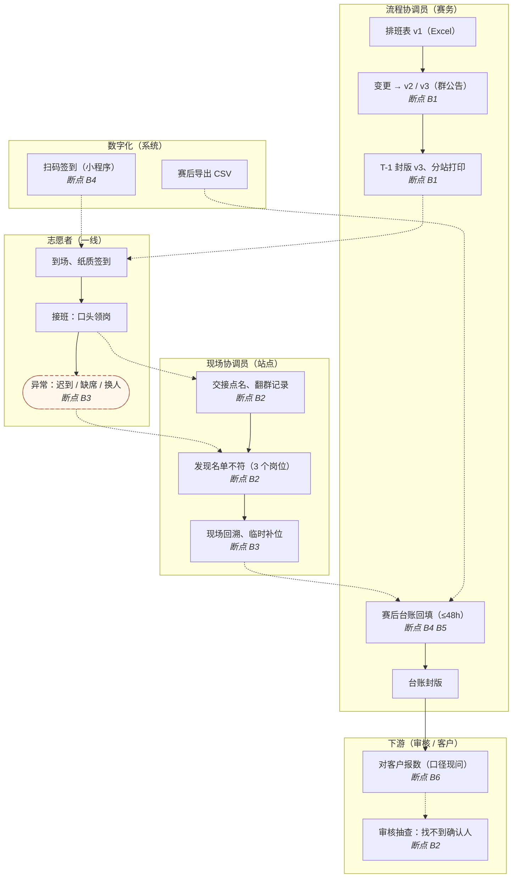

# 现状流程图（AS-IS）· 赛事志愿者排班与交接

> 案例编号：`dlg-sports-volunteers` ｜ 编号 `MAP-01`
> 这张图不是画着好看的，它要和 `docs/现场调研分析.md` §5 的六个断点一一对上。
> **图由代码生成**：改 `src/render_flow.py` 里的节点定义，重跑一次，三种格式一起更新——图、文字、台账不会各说一套。

---

## 1. 图



矢量版（可放大打印）：[现状流程图.svg](图/现状流程图.svg) ｜ 可编辑源：[现状流程图.mmd](图/现状流程图.mmd)

## 2. 可渲染版本（GitHub 直接显示）



## 3. 节点表

| 节点 | 泳道 | 动作 | 载体 | 是否留证 | 断点 |
|---|---|---|---|---|---|
| n1 | 赛务 | 排班表 v1 | Excel + 群文件 | 是（文件） | — |
| n2 | 赛务 | 变更 → v2 / v3 | Excel + 群公告 | 是，但无版本号 | B1 |
| n3 | 赛务 | T-1 封版、分站打印 | Excel → 纸 | 是（纸） | B1 |
| n4 | 一线 | 到场、纸质签到 | 纸 | 是（纸） | — |
| n5 | 一线 | 接班：口头领岗 | 口头 | **否** | — |
| n6 | 一线 | 异常：迟到 / 缺席 / 换人 | 微信群一句话 | **否** | B3 |
| n7 | 站点 | 交接点名、翻群记录 | 手机 + 纸 | 否（截图） | B2 |
| n8 | 站点 | 发现名单不符 | 口头 + 群 | 否 | B2 |
| n9 | 站点 | 现场回溯、临时补位 | 对讲机 | 否 | B3 |
| n10 | 赛务 | 赛后台账回填（≤48h） | Excel + 照片 | 是（事后补） | B4 B5 |
| n11 | 赛务 | 台账封版 | Excel | 是 | — |
| n12 | 系统 | 扫码签到（小程序） | 小程序 | 是（但会失败） | B4 |
| n13 | 系统 | 赛后导出 CSV | CSV | 是 | — |
| n14 | 下游 | 对客户报数 | 邮件 / 口头 | 否（口径未书面） | B6 |
| n15 | 下游 | 审核抽查 | — | **拿不到** | B2 |

## 4. 读图要点

1. **看虚线和实线的分布**：从 `n5`（接班领岗）到 `n9`（临时补位）这一段，**五个节点全是"不留证"的**。审核要的三个要素（谁、何时、哪个岗位），恰好全在这段里丢的。
2. **看岔口**：`n5 → n6`（异常）和 `n5 → n7`（正常交接）分开了，但两条路最后都汇到 `n8 发现不符`——也就是说，正常路径和异常路径在事后**无法区分**。
3. **看回流**：`n12 扫码签到` 有一根虚线指回 `n4 纸质签到`——扫码失败就退回纸，这是现场的真实兜底，也是重复录入的第一处。
4. **看末端**：`n10 / n13 / n9` 三条线汇进同一个台账，三种来源、三种口径，靠人脑合并。
5. **看最后一格**：`n15 审核抽查` 是整张图的终点，也是唯一拿不到东西的地方。

## 5. 断点 → 图上的位置

| 断点 | 位置 | 图上表现 |
|---|---|---|
| B1 排班多版本 | n2 → n3 | 版本变更只在群里说，无版本号，现场拿到的不一定是封版 |
| B2 交接无签字 | n5 / n7 / n8 / n15 | 一条虚线从口头直通审核，中间没有任何"确认"节点 |
| B3 换人不回填、无升级时限 | n6 → n8 → n9 | 异常走旁路，最终靠人跑回去 |
| B4 重复录入 | n4 + n12 → n10 | 两路并行录入，加一路 CSV 导出 |
| B5 台账靠照片回填 | n10 | 事后合并，工时全在这里 |
| B6 口径未书面 | n14 | 对外一步没有规则节点 |

## 6. 这张图不做什么

- 不画目标态（TO-BE）。阶段 1 只到"看清现在"，方案留在阶段 2。提前画目标态，容易把"想做的"当成"需要的"。
- 不画部门组织结构。泳道按**动作的责任人**分，不按头衔分——同一个人在图上可能出现在两条泳道里（比如现场协调员既点名又补位）。

## 7. 重绘

```bash
python src/render_flow.py          # 重新生成 svg / png / mmd
python src/render_flow.py --check  # 只校验：节点 id 唯一、连线路由存在、断点编号合法
```

改图只改 `src/render_flow.py` 里的 `NODES` / `EDGES` 两张表。
