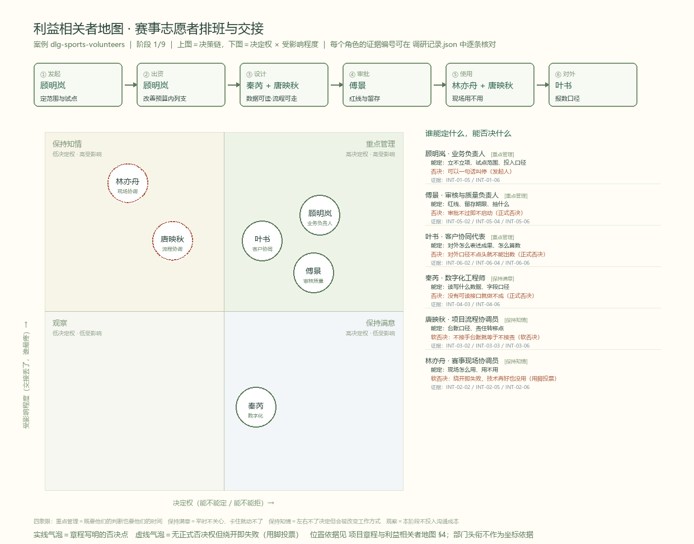

# 项目章程与利益相关者地图 · 赛事志愿者排班与交接

> 案例编号：`dlg-sports-volunteers` ｜ 阶段 1/9 ｜ 对应平台任务 **3/3「确认立项与决策链」**
> 任务交付物：**项目章程与利益相关者地图**
> 依据：`docs/原始资料/04-利益相关者资料与分工.html`（`case-ROLE`）、`docs/调研记录.md`（36 条）、`docs/业务挖掘.md` §3、`docs/现状基线与价值假设.md`
> 图：`docs/图/利益相关者地图.png` / `.svg` / `.mmd`，由 `src/render_stakeholders.py` 生成

---

## 0. 这份文件回答四个问题

1. **谁发起、谁出钱、谁审批、谁使用**——不是画组织架构，是找"谁能一句话叫停"。
2. **决策从哪走到哪**——六段链条，每段都要有输入、输出和卡点，缺一段就会在试点中途卡住。
3. **访谈授权到哪为止**——谁说的事能算数，谁不能替别人确认。
4. **什么情况下不启动、什么情况下停**——章程没有退出条件的，等于没有章程。

---

## 1. 一页章程

| 项 | 内容 | 状态 |
|---|---|---|
| 项目名 | 赛事志愿者排班与交接 · 交接时刻的口径统一与留证 | — |
| 案例编号 | `dlg-sports-volunteers` | — |
| 阶段 | 1/9 业务挖掘（本阶段只到"值不值得立项 + 边界"） | — |
| **发起人** | 顾明岚（业务负责人） | `INT-01-05` |
| **出资者** | 顾明岚；列支科目为赛事运营改善预算，不单独立项 | `INT-01-06`，额度 `［待核］` |
| **审批者** | 傅景（红线与留存）；对外口径另需叶书点头 | `INT-05-02`、`INT-06-04` |
| **使用者** | 林亦舟（现场执行）、唐映秋（台账）；一线组长是最终判定者 | `INT-02-06`、`INT-03-02` |
| **数据提供者** | 秦芮（只读导出，无写回接口） | `INT-04-03`、`INT-04-06` |
| **受益者** | 现场协调员（少跑腿）、赛务（少返工）、叶书（报数一次说清） | `INT-02-03`、`INT-03-06`、`INT-06-02` |
| **做** | 只读核对排班/签到/交接记录；交接确认落"人 + 时间 + 岗位"；不一致走人工确认并设升级时限；输出可归档的交接留证 | `case-SCOPE` |
| **不做** | 自动派班、写回排班系统、人脸识别与身份核验、替代客户验收、对外承诺收益 | `业务挖掘.md` §7 |
| **试点边界** | 1 场赛事 · 2 个站点（4 号主试、2 号对照）· 1 个交接窗口（第 1→2 班）· 4 类记录 | `业务挖掘.md` §3.3 |
| **成功标准** | M1 ≤5 分钟、M2 = 0 且 5 分钟内定位到人、M3 = 100%，**三条同时达标** | `现状基线与价值假设.md` §3.1 |
| **预算** | 未估。顾明岚要求先算清返工人时再谈投入 | `INT-01-04`，`［待核］` |
| **时间** | 一场赛事为一个验证周期（约 3 周：T-7 发布 → 赛后 3 天报数） | `case-BRIEF` |
| **退出条件** | 见 §5 四条门槛，任一未过即不启动；试点中任一否决点收回即停 | — |
| **资料性质** | 合成训练资料，不代表真实授权、业务执行或客户验收 | `case-BRIEF` |

---

## 2. 四类人：发起人 / 出资者 / 审批者 / 使用者

平台要求"明确业务发起人、使用者、出资者、审批者"，并且这四类**常常不是四个人，而是六个人交叉担任**。这是本案最容易出错的地方——把"顾明岚是业务负责人"直接当成"顾明岚全都能定"。

| 类别 | 谁 | 能定什么 | 能拒什么 | 不能替谁确认 | 证据 |
|---|---|---|---|---|---|
| **发起人** | 顾明岚 | 立不立项、试点范围多大、什么时候启停 | 一句话叫停 | 现场细节、系统能力、审核红线 | `INT-01-05` |
| **出资者** | 顾明岚（赛事运营改善预算） | 出多少、走哪个科目 | 预算不批 | 科目与额度未书面，`［待核］` | `INT-01-06`、`INT-01-04` |
| **审批者** | 傅景（红线/留存）、叶书（对外口径）、秦芮（读写权限） | 各自的通过与否决 | **都是正式否决点** | 业务取舍（顾明岚）、现场操作（林亦舟） | `INT-05-02`、`INT-06-04`、`INT-04-03` |
| **使用者** | 林亦舟（现场）、唐映秋（台账） | 怎么用、用不用、台账怎么记 | 绕开即失败（无正式否决权，但比否决更硬） | 预算、权限、对外口径 | `INT-02-06`、`INT-03-03` |

> **一句总结**：审批者能"否决"，使用者能"让它白做"。章程里写清楚两者的区别，才不会把"审批通过了"当成"能落地"。

---

## 3. 决策链（六段）

| # | 环节 | 谁 | 输入 | 输出 | 卡点 | 证据 |
|---|---|---|---|---|---|---|
| ① | 发起 | 顾明岚 | 07:20 那次异常 | "值得立项"的判断与范围 | 预算不接受"整体系统" | `INT-01-01`、`INT-01-06` |
| ② | 出资 | 顾明岚 | 返工人时测算 | 能否列支、列多少 | **测算没做，钱就谈不下去** | `INT-01-04` |
| ③ | 设计 | 秦芮 + 唐映秋 | 三样可读数据 | 只读核对与确认记录的结构 | 数据只有排班 Excel / 签到 CSV / 分站名单 | `INT-04-06`、`INT-03-02` |
| ④ | 审批 | 傅景 | 记录字段与留存方案 | 通过 / 打回 | 个人信息与生物识别红线 | `INT-05-01`、`INT-05-04` |
| ⑤ | 使用 | 林亦舟 + 唐映秋 | 交接流程 | 现场实际执行 | 手套、风、信号一格；一旦麻烦就回群里 | `INT-02-05`、`INT-02-06` |
| ⑥ | 对外 | 叶书 | 台账与交接记录 | 对客户报数 | 迟到/换人算不算在岗，须书面口径 | `INT-06-02`、`INT-06-06` |

**链条上两个最细的脖子**：

- **②出资** 卡在"返工人时"这个数上。`INT-03-06` 说 16 人时，但那是单源、无凭证。**这个数不实，项目连预算会都开不了。**
- **⑤使用** 卡在"多一步就绕开"上。`INT-02-06` 已经证明一线会自建替代物（群里回"接班确认"）。所以设计约束不是"功能全"，是**现场比现在少一步**。

---

## 4. 利益相关者地图

矢量版：[利益相关者地图.svg](图/利益相关者地图.svg) ｜ 可编辑源：[利益相关者地图.mmd](图/利益相关者地图.mmd)

### 4.1 两个坐标怎么定

| 轴 | 含义 | 判定依据（不是头衔，是行为） |
|---|---|---|
| **横轴：决定权** | 能不能定、能不能拒 | 章程或访谈里有没有"我说了算 / 过不去就过不去"的原话 |
| **纵轴：受影响程度** | 交接出问题，谁最疼 | 有没有直接承担后果（返工、跑腿、被客户追问、审计举证） |

> **头衔不作为坐标依据**：秦芮是工程师，但她的权力来自"没有可读接口就做不成"，不是来自职级；林亦舟没有否决权，但一线绕开就等于否决。

### 4.2 六个角色的落点与理由

| 角色 | 象限 | 决定权 | 受影响 | 落点理由 | 证据 |
|---|---|---|---|---|---|
| 顾明岚 · 业务负责人 | 重点管理 | 高 | 高 | 定范围与出资，同时要对客户交代结果 | `INT-01-05`、`INT-01-06` |
| 傅景 · 审核与质量 | 重点管理 | 高 | 高 | 红线否决 + 每个赛季亲手抽 20 份交接 | `INT-05-03`、`INT-05-06` |
| 叶书 · 客户协同 | 重点管理 | 高 | 高 | 对外口径否决权；客户空窗曾直接打到他这里 | `INT-06-03`、`INT-06-04` |
| 唐映秋 · 项目流程 | 保持知情 | 低 | 高 | 台账与责任转移点的实际承担者，但范围不由她定 | `INT-03-03`、`INT-03-06` |
| 林亦舟 · 赛事现场 | 保持知情 | 低（软否决） | 最高 | 无正式否决权，但绕开即失败；受影响最直接 | `INT-02-02`、`INT-02-06` |
| 秦芮 · 数字化 | 保持满意 | 高 | 低 | 数据读写一票否决；但业务结果好坏与他的考核无关 | `INT-04-03`、`INT-04-06` |

**为什么"观察"象限是空的**：本案六个人没有一个是"低权力 + 低受影响"。这不是巧合——一次 40 分钟的岗位空窗会同时打到现场、赛务、客户三方。空的象限本身就是一个发现：**这件事没有旁观者**。

### 4.3 四个象限的应对方式

| 象限 | 人 | 对他们做什么 | 不做什么 |
|---|---|---|---|
| **重点管理** | 顾明岚、傅景、叶书 | 立项前一对一过边界；每个否决点单独留书面确认；试点结果先给他们看 | 不在会上"顺便提一下"就算征求过意见 |
| **保持知情** | 唐映秋、林亦舟 | 让他们参与设计而不是验收；试点前做白纸推演；改一步问一次 | 不把方案做完再拿去"培训" |
| **保持满意** | 秦芮 | 一开始就问"能给什么数据"，按他给的边界设计 | 不假设"加个字段就行" |
| **观察** | —（无人） | 本阶段不投入沟通成本 | — |

### 4.4 图上那句"软否决"是什么意思

林亦舟和唐映秋没有否决权，但他们的"不配合"比否决更彻底：

- 林亦舟可以在群里继续发"接班确认"，让新记录变成第二套账（`INT-02-06`）；
- 唐映秋可以继续用她自己的 Excel 台账，让赛后台账与新记录对不上（`INT-03-02`）。

**处理办法**：把这两人的接受度当成**前置门槛**（§5 第 4 条），而不是试点结束后的满意度调查。

---

## 5. 否决点与启动门槛

试点启动前，逐条打勾。**任一条未过，不启动**——不是"降级启动"，是不启动。

| # | 门槛 | 谁签 | 判定标准 | 现状 |
|---|---|---|---|---|
| 1 | 红线与留存方案通过 | 傅景 | 不落身份证/手机号；无人脸；留存 ≥1 个赛季；截图不作凭证 | 未过 |
| 2 | 对外口径书面化 | 叶书（+ 顾明岚） | "迟到/换人算不算在岗"有一页书面定义，三方签字 | 未过 |
| 3 | 数据可读确认 | 秦芮 | 三样数据（排班 Excel / 签到 CSV / 分站名单）字段与更新时点书面确认 | 未过 |
| 4 | 一线接受度 | 林亦舟（+ 2 名组长） | 白纸推演中不出现"先按你们说的做，回头群里再说一遍" | 未过 |
| 5 | 范围与预算口径 | 顾明岚 | 接受"一节赛事、两站、一个交接窗口"的范围；返工人时有测算口径 | 未过 |

**停的条件**（试点中触发任一条即停）：

1. 一线自建群消息量上升（说明工具没接住现场）；
2. 交接记录条数 ÷ 实际在岗人次 > 1.2（说明在补录凑数）；
3. 出现"无差异"但抽查查出差异（说明差异被抹平而非消除）；
4. 傅景或叶书任一方收回意见。

---

## 6. 访谈授权与调查边界

### 6.1 授权原则

`case-ROLE` 明确写了每位角色的协作要求：**"说明自己接收谁的输入、向谁交接，提供对应记录；与其他角色交叉核实，不能替其他角色确认权限或业务事实。"**

这一句话决定了本案全部的取证纪律：

| 原则 | 含义 | 落地做法 |
|---|---|---|
| 只谈自己职责内的动作 | 林亦舟能说现场怎么点名，不能说预算 | 访谈提纲按 `focus` 分工（见 `调研记录.md` §1） |
| 不替他人确认权限 | 顾明岚说"要问秦芮"就是没确认，不能记成"已确认" | 权限类陈述一律回到本人 |
| 交叉核实而非采信 | 同一事实至少两个角色独立确认 | `调研记录.md` §8 交叉核对表；单源 11 条不进结论 |
| 记录可追溯 | 每条陈述带证据编号与原话 | `docs/调研记录.json` 为唯一真源 |

### 6.2 调查边界

| 允许调查 | 不允许调查 / 不采集 |
|---|---|
| 排班表版本与变更过程 | 志愿者身份证号、手机号等个人信息 |
| 签到与交接的实际动作、时刻、载体 | 人脸、指纹等生物识别数据 |
| 赛后台账的回填流程与人时 | 志愿者个人评价、考勤扣罚记录 |
| 审核抽查的字段与留存要求 | 客户合同金额、报价与商务条款 |
| 对外报数的口径争议 | 未脱敏的原始签到表照片（只收脱敏件） |

**四条边界声明**（写进任何对外材料）：

1. 本案为**合成训练资料**，不代表真实授权、业务执行或客户验收（`case-BRIEF`）。
2. 全部引语为**演练访谈整理**，不代表客户已确认的陈述。
3. 原始凭证（DOC-01～DOC-04）**全部待补**，未取得原件前所有数字只作估计。
4. 本项目**不预设预算、不预设根因、不承诺收益**。

### 6.3 授权状态逐条登记

| 角色 | 可谈范围（focus） | 记录人 | 授权状态 | 备注 |
|---|---|---|---|---|
| 顾明岚 | 业务目标与试点决策 | 调研者 | 演练授权 | 预算科目待书面 |
| 林亦舟 | 现场操作与异常处理 | 调研者 | 演练授权 | 现场照片需脱敏 |
| 唐映秋 | 流程交接与资料责任 | 调研者 | 演练授权 | 台账原件待补 |
| 秦芮 | 系统数据与集成条件 | 调研者 | 演练授权 | 字段清单待书面 |
| 傅景 | 风险控制与审核边界 | 调研者 | 演练授权 | 留存期限待确认 |
| 叶书 | 客户体验与协作反馈 | 调研者 | 演练授权 | 客户侧口径需商务确认 |

> "演练授权"是本案的诚实说法：访谈在角色卡与问题库约束下进行，**不是真实客户授权**。真实项目里这一列必须换成签署过的访谈知情同意。

---

## 7. 章程的变更与待核

| 项 | 现状 | 待谁确认 | 影响 |
|---|---|---|---|
| 预算科目与额度 | 未书面 | 顾明岚 | 章程第 ② 段能否走通 |
| 出资是否需走采购流程 | 未知 | 顾明岚 + 财务 | 决定试点能否在"一季内"落地 |
| 留存期限的准确要求 | "至少一个赛季" | 傅景 + DOC-04 | M3 字段设计 |
| 客户侧口径能否书面化 | 未定 | 叶书 + 客户 | 门槛 2 卡在这里 |
| 试点的对照站点选哪个 | 建议 2 号站 | 林亦舟 | 对照有效性 |

**章程版本**：v0.1（阶段 1 交付）。任何一条改动都要改版本号并注明依据——包括"改主意"这件事本身也要留记录。

---

## 8. 我的理解与结论（可直接填入平台"我的理解与结论"）

> 本项目的发起人是业务负责人顾明岚，出资也走他这条线（赛事运营改善预算，不单独立项，额度未书面）；审批者不是一个而是一组——傅景管红线与留存、叶书管对外口径、秦芮管数据读写权限，三人都是正式否决点；使用者是林亦舟（现场执行）与唐映秋（台账），他们虽无否决权，但一线绕开就等于项目失败，这一点比否决更硬。
>
> 决策链共六段：发起 → 出资 → 设计 → 审批 → 使用 → 对外。两个最细的脖子：一是"出资"卡在返工人时的测算上（16 人时目前是单源、无凭证），数字不实连预算会都开不了；二是"使用"卡在"多一步就绕开"上，一线已经自建了替代物（群里回"接班确认"），所以设计约束不是功能全，而是现场比现在少一步。
>
> 利益相关者地图按"决定权 × 受影响程度"两轴定位，头衔不作为依据。顾明岚、傅景、叶书落在重点管理（既能定、也最疼）；唐映秋、林亦舟落在保持知情（定不了，但会被改变工作方式，且是实际承担后果的人）；秦芮落在保持满意（数据读写能否决，但业务结果与他无关）。"观察"象限是空的——一次 40 分钟岗位空窗会同时打到现场、赛务、客户三方，这件事没有旁观者。
>
> 调查边界写在章程里：每位角色只谈自己职责内的动作、不替他人确认权限、同一事实至少两个角色独立确认（36 条中仍有 11 条单源，不进结论）；不采集身份证号手机号、不碰人脸等生物识别、不收未脱敏签到表照片、不碰合同商务条款。全部资料为合成训练，原始凭证 DOC-01～DOC-04 待补，未取得前所有数字只作估计，不预设预算、不预设根因、不承诺收益。
>
> 启动前有五条门槛（红线与留存、对外口径书面化、数据可读确认、一线接受度、范围与预算口径），任一条未过即不启动；试点中若一线新建群消息量上升、交接记录条数/在岗人次 > 1.2、或"无差异"抽查查出差异，立即停。目前五条门槛全部未过——这正是阶段 2 的第一批任务。

---

## 9. 与其它文件的关系

| 文件 | 关系 |
|---|---|
| `docs/业务挖掘.md` §3 | 决定权矩阵的一页版，本文件是其展开与可视化 |
| `docs/现状基线与价值假设.md` | 成功标准（M1–M3）进章程；取证责任人对应本文件的四个否决点 |
| `docs/调研记录.md` | 章程里每条"能定/能否决"都挂了证据编号，可逐条回查 |
| `src/render_stakeholders.py` | 地图的唯一来源；改位置改这里，图和文字不会各说一套 |
